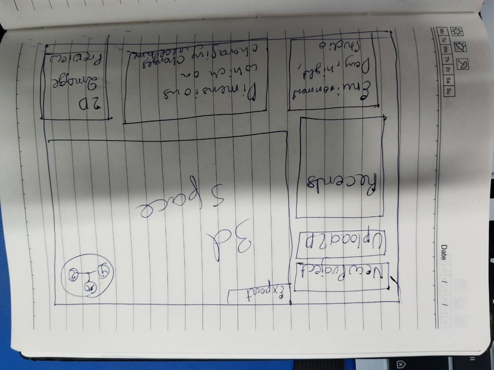

# BEYOND - 2D 🏠
### Deterministic Architectural 2D-to-3D Floor Plan Workspace & Vision Engine

[](https://beyond-2-d.vercel.app)
[](https://github.com/SankalpPandey-56/Beyond-2D/actions)
[](https://fastapi.tiangolo.com)
[](https://threejs.org)
[](https://www.python.org/)
[](LICENSE)

<p align="center">
  <a href="https://beyond-2-d.vercel.app">
    
  </a>
  &nbsp;&nbsp;
  <a href="https://docs.google.com/presentation/d/1kRvLJi1CCHGJVujw9Ap-ibzly19bNGKXY7FqpqgY3Ws/edit?usp=sharing">
    
  </a>
  &nbsp;&nbsp;
  <a href="docs/Beyond-2D_Architecture_Feasibility_Report.pdf">
    
  </a>
  &nbsp;&nbsp;
  <a href="docs/Beyond-2D_Python_Architecture_and_Logic_Guide.pdf">
    
  </a>
</p>

---



---

## 💡 Overview

Reading traditional 2D architectural blueprints is challenging for non-specialists. Understanding spatial flow, daylighting, volume, and clearance from flat line drawings often leads to costly miscommunication between homeowners and builders.

**BEYOND - 2D** converts static 2D blueprint drawings (PNG, JPG, SVG) into a **watertight, photorealistic 3D architectural model in seconds**. Combining deterministic OpenCV computer vision, dual-image Gemini Vision AI, and Shapely planar topology with a Three.js WebGL viewport, Beyond-2D bridges the gap between 2D drafting and real-time spatial exploration.

---

## ✨ Key Features

- **⚡ Deterministic Computer Vision + Gemini Vision AI**:
  - Automatically isolates building footprints, filters dimension annotations, and identifies structural walls using OpenCV morphological closing (`cv2.morphologyEx`).
  - Analyzes room topologies and exact window/door opening coordinates via Gemini Vision without hallucinating unwanted openings on solid or bathroom walls.
- **📐 Watertight Planar Geometry Engine**:
  - Uses Shapely 2D planar boolean operations (`unary_union`, boundary intersection) to construct $100\%$ watertight rectilinear wall networks with clean adjoining partitions.
- **🎨 Interactive 3D Studio (Three.js)**:
  - Studio-grade lighting, filmic ACES tone-mapping, PCF soft shadow maps, and ambient fog.
  - Interactive PlanPop CAD color mode (Red walls, Blue doors, Cyan windows) and realistic Monograph architectural finishes.
- **🚶 First-Person Eye-Level Walkthrough Mode**:
  - Smooth camera transition to $1.65\text{ m}$ human eye-level with natural $80^\circ$ FOV.
  - Fully navigable on desktop via **WASD / Arrow Keys** and on mobile via an **on-screen touch D-Pad**.
- **☀️ Real-Time Sun Path Heliodon**:
  - Dynamic solar slider simulating daylight color temperatures ($2800\text{ K}$ golden hour to $6500\text{ K}$ midday) and physical cast shadow angles.
- **📏 Live Parametric Dimension Controls**:
  - Real-time sliders for width ($X$), length ($Z$), wall height ($Y$), and wall thickness with instant 3D mesh regeneration.
- **📱 Native Mobile Phone Responsiveness**:
  - Fully touch-responsive layout with sliding bottom sheets for Room Lists and Material Catalogs, two-finger pinch-to-zoom, and safe area insets.
- **💾 Multi-Format Architectural Export**:
  - One-click binary **GLB 3D model** export for Blender/Unreal Engine.
  - High-resolution $2400 \times 1600\text{ px}$ **Architectural Presentation Board** export with title block.

---

## ⚙️ System Architecture

```text
  [ 2D Blueprint Image ]
            │
            ▼
 ┌─────────────────────────────────────────────────────────┐
 │ 1. Deterministic Image Preprocessing (OpenCV)           │
 │    • Adaptive thresholding & skew correction            │
 │    • Morphological wall closing (25x25 kernel)          │
 │    • Structural footprint bounding-box isolation        │
 └──────────────────────────┬──────────────────────────────┘
                            │
                            ▼
 ┌─────────────────────────────────────────────────────────┐
 │ 2. Dual-Image Vision AI Interpretation (Gemini)         │
 │    • Image 1: Full blueprint (labeled dimension text)   │
 │    • Image 2: Isolated footprint (normalized coords)    │
 │    • Zero-hallucination door & window extraction        │
 └──────────────────────────┬──────────────────────────────┘
                            │
                            ▼
 ┌─────────────────────────────────────────────────────────┐
 │ 3. Planar Topological Reconstruction (Shapely)          │
 │    • unary_union(polys).boundary → Exterior perimeter   │
 │    • polyA ∩ polyB → Interior partitions (Forbidden door│
 │      adjacency prevention: Kitchen ↮ Washroom)          │
 └──────────────────────────┬──────────────────────────────┘
                            │
                            ▼
 ┌─────────────────────────────────────────────────────────┐
 │ 4. 3D Scene Assembly & Verification (Three.js / Trimesh)│
 │    • Extruded wall prisms with lintels & sills          │
 │    • Real-time filmic shading, shadows, and materials   │
 │    • GLB 3D export & presentation board renderer        │
 └─────────────────────────────────────────────────────────┘
```

---

## 🛠️ Technology Stack

| Layer | Technologies |
| :--- | :--- |
| **3D Frontend Workspace** | HTML5, CSS3, JavaScript (ES6+), **Three.js (r128)**, Filmic Tone-Mapping, Touch Events |
| **Vision & Geometry Engine** | **Python 3.9+**, **FastAPI**, **Uvicorn**, **OpenCV (cv2)**, **NumPy**, **Shapely 2.0**, **Trimesh** |
| **Vision AI** | **Google Gemini Vision AI** (`gemini-3.1-flash-lite-preview`, `gemini-flash-latest`) |
| **Cloud Hosting** | **Vercel** (Global Edge CDN, static asset routing via `vercel.json`) |
| **CI / CD** | **GitHub Actions** (Automated Python unittest pipeline & frontend build validation) |

---

## 🚀 Quickstart Guide

### Prerequisites
- **Node.js** 18+ and **npm**
- **Python** 3.9+ and **pip**

### 1. Clone the Repository
```bash
git clone https://github.com/SankalpPandey-56/Beyond-2D.git
cd Beyond-2D
```

### 2. Configure Environment Variables
Create a `.env` file in `backend-python/`:
```bash
cp backend-python/.env.example backend-python/.env
```
Add your Google Gemini API key:
```env
GEMINI_API_KEY=your_gemini_api_key_here
GEMINI_MODEL=gemini-3.1-flash-lite-preview
```

### 3. Start the Backend (FastAPI Vision Engine)
```bash
cd backend-python
pip install -r requirements.txt
python3 -m uvicorn app.main:app --host 0.0.0.0 --port 8001 --reload
```
*Backend active at: `http://localhost:8001`*  
*Interactive Swagger API Docs: `http://localhost:8001/docs`*

### 4. Start the Frontend (FORM Studio Workspace)
In a new terminal window:
```bash
npm start
```
*Frontend workspace running at: `http://localhost:3000`*

---

## 🧪 Running Automated Tests

Run the complete architectural geometry test suite:
```bash
PYTHONPATH=backend-python python3 -m unittest discover -s backend-python/tests -p "test_*.py"
```

Verify frontend production build:
```bash
npm run build
```

---

## 📁 Project Directory Structure

```text
Beyond-2D/
├── .github/
│   └── workflows/
│       └── ci.yml               # GitHub Actions CI workflow
├── assets/
│   ├── perfect_floorplan.png    # Benchmark test blueprint
│   └── preview.jpg              # High-resolution workspace preview
├── docs/
│   ├── Beyond-2D_Architecture_Feasibility_Report.pdf
│   └── report.html              # Architectural analysis report
├── backend-python/
│   ├── app/
│   │   ├── api/
│   │   │   └── routes.py        # /api/analyze-floorplan & /api/export-glb
│   │   ├── schemas/             # Pydantic data models
│   │   ├── services/
│   │   │   ├── ai_interpretation.py   # Gemini Vision AI integration
│   │   │   ├── dynamic_geometry.py    # Shapely planar wall network & openings
│   │   │   ├── image_preprocessing.py # OpenCV morphological filtering
│   │   │   ├── mesh_generation.py     # Trimesh 3D scene & GLB generator
│   │   │   └── pipeline.py            # End-to-end processing pipeline
│   │   ├── config.py            # Architectural dimensions & palettes
│   │   └── main.py              # FastAPI application entrypoint
│   ├── tests/                   # Automated unittest test suites
│   ├── requirements.txt         # Python dependencies
│   └── .env.example
├── frontend-form-studio/
│   ├── index.html               # Three.js 3D Workspace, controls & mobile drawer
│   ├── samples/                 # Sample benchmark plans
│   └── server.js                # Lightweight local development proxy
├── public/                      # Compiled production assets for Vercel
├── vercel.json                  # Vercel deployment & routing configuration
├── package.json                 # Project build & script definitions
├── LICENSE                      # MIT Open-Source License
└── README.md                    # Project documentation
```

---

## 👥 Contributors

- **Sankalp Pandey** ([@SankalpPandey-56](https://github.com/SankalpPandey-56)) — Core Architecture, Computer Vision & 3D WebGL Pipeline
- Built with passion as part of the **Hacktober** initiative.

---

## 📄 License

This project is licensed under the [MIT License](LICENSE) — see the LICENSE file for details.
